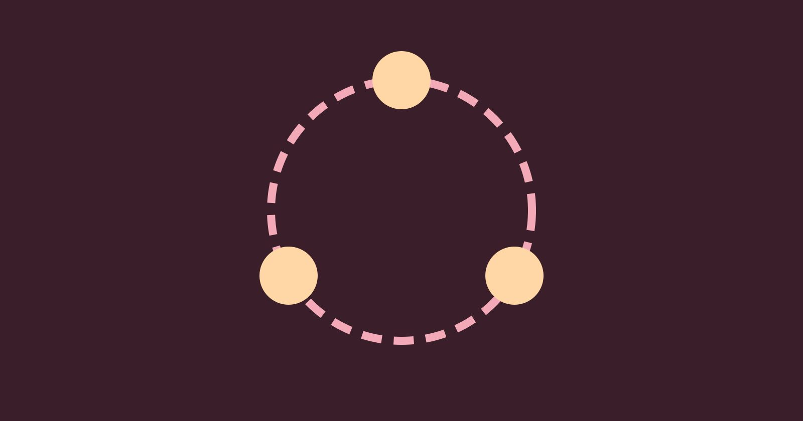

सुबह उठकर फ़ोन देखना, खाने के बाद मीठा खाना, गाड़ी में बैठते ही सीट बेल्ट लगाना। ये सब आदतें हैं। हमारा दिमाग रोज़ के कामों को स्वचालित बना देता है ताकि उसे हर बार सोचना न पड़े।

## आदत का चक्र

लेखक चार्ल्स डुहिग ने अपनी किताब *The Power of Habit* में आदत को तीन हिस्सों वाले चक्र के रूप में समझाया है:

1. **संकेत (Cue):** वह चीज़ जो आदत को शुरू करती है, जैसे समय, जगह या मूड।
2. **क्रिया (Routine):** वह काम जो आप करते हैं।
3. **इनाम (Reward):** वह फ़ायदा या अच्छा एहसास जो दिमाग को "दोबारा करो" का संदेश देता है।

## आदत बनने में कितना समय लगता है?

अक्सर कहा जाता है कि 21 दिन में आदत बन जाती है, लेकिन शोध कुछ और बताता है। 2009 में लंदन के यूनिवर्सिटी कॉलेज के एक अध्ययन में पाया गया कि किसी नए व्यवहार के स्वचालित होने में औसतन लगभग 66 दिन लगे, और अलग-अलग लोगों व आदतों में यह समय 18 से 254 दिन तक रहा।

> एक दिन चूक जाना कोई समस्या नहीं है। असली बात है अगले दिन फिर शुरू करना।

## अच्छी आदत कैसे बनाएँ

- **छोटा शुरू करें:** रोज़ 2 मिनट पढ़ना, एक पन्ना लिखना, या 5 मिनट टहलना।
- **पुरानी आदत से जोड़ें:** "चाय पीने के बाद 10 मिनट पढ़ूँगा।"
- **संकेत दिखाई दे:** किताब तकिये के पास रखें, पानी की बोतल मेज़ पर।
- **इनाम दें:** हर दिन के बाद कैलेंडर पर निशान लगाएँ।

## बुरी आदत कैसे छोड़ें

संकेत को पहचानें और उसे कम करें। जैसे, फ़ोन पर घंटों स्क्रॉल करने की आदत हो तो सोने से पहले फ़ोन को दूसरे कमरे में चार्ज करें। फिर उसी इनाम को किसी बेहतर क्रिया से पाने की कोशिश करें, जैसे संगीत सुनना या किताब पढ़ना।

## निष्कर्ष

आदतें इच्छाशक्ति से कम और बनावट (design) से ज़्यादा बनती हैं। अपने आस-पास का माहौल बदलें, छोटे कदम लें, और धैर्य रखें।
